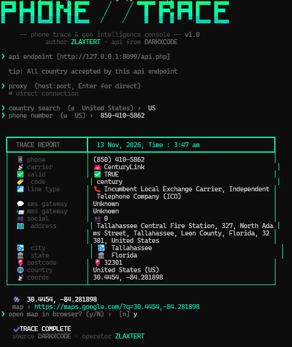

## PHONE-TRACEV1.0.1

The console resolves carrier, line type, SMS gateway, registered area and coordinates — then plots them on the map.

<h1 align="center">
   
  
   
  PHONE // TRACE V 1.0
   
</h1>

  
  

 • <a href="https://api.darkxcode.site/phone-tracking/docs.php">API Docs</a> •
  <a href="https://api.darkxcode.site/phone-tracking/">Live Trace</a> •
  <a href="https://darkxcode.site/">Other Tools</a> •

## Output

This is the result if the code is successfully validation.

---

> **NOTE**
> Warning All the information provided here is intended solely for educational and testing purposes.
> I do not endorse any illegal activities or unfair usage of this program.
